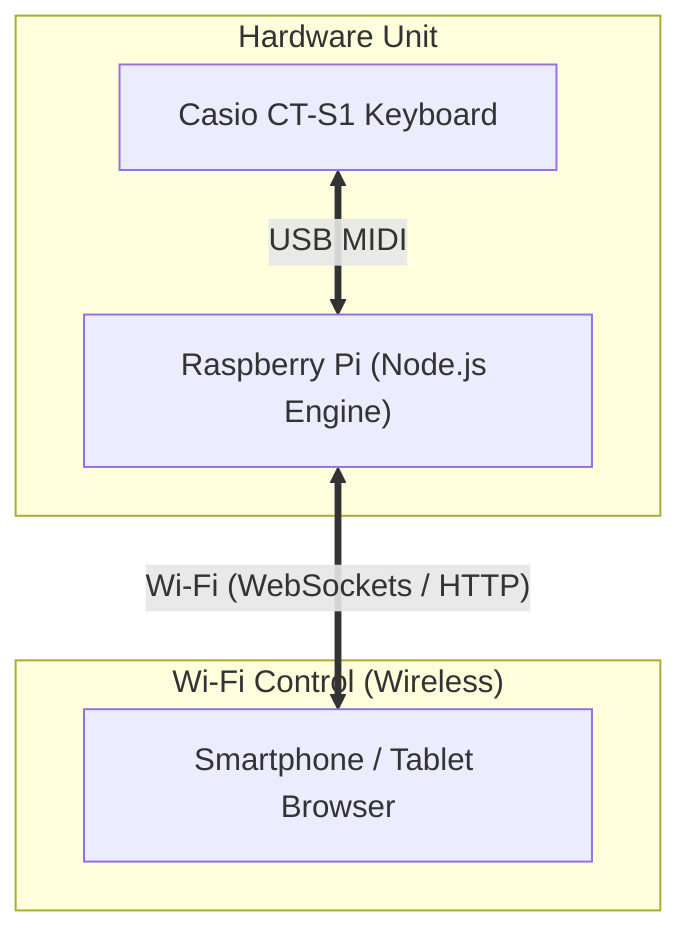

# Concept & Architecture: Standalone Raspberry Pi Rhythm Box with Wi-Fi Remote

This document details the concept, hardware setup, software architecture, and Wi-Fi remote design for building a **standalone Boss DR-01s Rhythm Partner Box** for the **Casio CT-S1 keyboard** powered by a Raspberry Pi.

---

## 1. System Overview & Architecture

The system operates as an **autonomous hardware unit**. Once powered on, the Raspberry Pi boots automatically, connects to the Casio CT-S1 via USB MIDI, launches the drum engine, and hosts a Wi-Fi remote web interface accessible from any smartphone, iPad, or tablet.



---

## 2. Wi-Fi Web Remote Concept

### A. Touchscreen UX / UI Concept
The mobile web interface is optimized for phone and tablet screens positioned on your keyboard music stand:

- **Large Transport Card**: High-contrast **PLAY / PAUSE** toggle with glowing indicator state.
- **BPM & Tempo Control**: Touch slider, `+5` / `-5` buttons, and **Tap Tempo** button for quick tempo matching.
- **Style Selector Carousel**: One-touch selection across all 10 groove styles (Funk, Hip Hop, Lofi Jazz, Bossa Nova, Waltz, Blues Shuffle, etc.).
- **9 Instrument Layer Cards**: Instant toggle switches to mute/unmute individual percussion instruments (Shaker, Tambourine, Claps, Kick, Snare, Hi-Hats, Congas, Cymbals, Wood Block).
- **Real-Time Step Visualizer**: Animated LED bar showing current step progress (`1..16`).

### B. Network Connectivity Modes

1. **Home Wi-Fi Mode**:
   - The Pi connects to your home network.
   - Access the remote from any phone on the network at `http://rhythm-box.local:3000`.

2. **Standalone Access Point (Hotspot) Mode**:
   - For gigs, outdoor rehearsals, or locations without Wi-Fi, the Pi broadcasts its own Wi-Fi network (e.g., `CT-S1-Rhythm-Box`).
   - Connect your phone directly to the Pi's Wi-Fi and open `http://192.168.4.1:3000`.

---

## 3. Raspberry Pi Hardware & Setup Blueprint

### A. Bill of Materials (BOM)

| Component | Recommended Model | Notes |
| :--- | :--- | :--- |
| **Microcontroller / SBC** | **Raspberry Pi Zero 2 W** (or Pi 4 / 5) | Compact, ultra-low power consumption (~1W), fast boot time. |
| **MicroSD Card** | 16GB Class 10 MicroSD | Raspberry Pi OS Lite (64-bit, headless). |
| **USB Cable** | Micro-USB / USB-C to USB-A | Connects Pi USB OTG/Host port to Casio CT-S1 USB Micro-B port. |
| **Power Supply** | 5V / 2.5A Power Adapter or Power Bank | Can run for 8+ hours on a standard 10,000mAh portable power bank! |

### B. Software Stack
- **OS**: Raspberry Pi OS Lite (headless, no desktop GUI required for maximum performance).
- **Runtime**: Node.js 20+ with ALSA MIDI (`alsa-utils`, `libasound2-dev`).
- **Engine**: Modular JZZ Rhythm Engine (`src/midi/player.js`).
- **Wi-Fi Server**: Express / Socket.io server broadcasting state updates to connected phone clients.

### C. Systemd Autostart Configuration
Create `/etc/systemd/system/rhythm-box.service`:

```ini
[Unit]
Description=Casio CT-S1 Rhythm Partner Engine & Wi-Fi Remote
After=network.target sound.target

[Service]
Type=simple
User=pi
WorkingDirectory=/home/pi/casio-cts1
ExecStart=/usr/bin/node server.js
Restart=always
RestartSec=3
Environment=NODE_ENV=production

[Install]
WantedBy=multi-user.target
```

---

## 4. Hands-Free Keyboard Control (Optional Expansion)

In addition to the Wi-Fi remote, the Raspberry Pi can monitor MIDI key presses directly from the **Casio CT-S1**:

- **Lowest Key (C1)**: Play / Pause toggle
- **Keys D1 / E1**: Tempo Down / Tempo Up
- **Keys F1 / G1**: Previous / Next Groove Style

This allows you to control rhythm playback during live performances without taking your hands off the keyboard!
